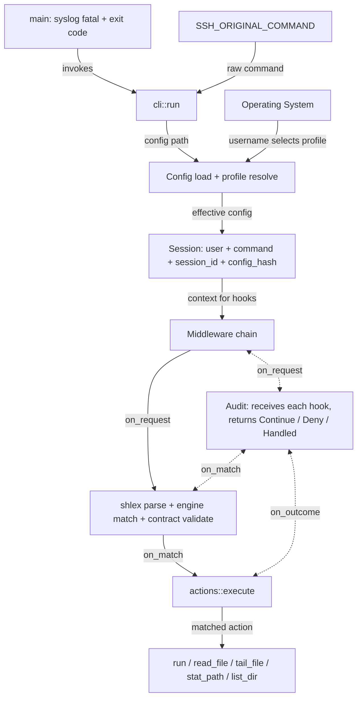
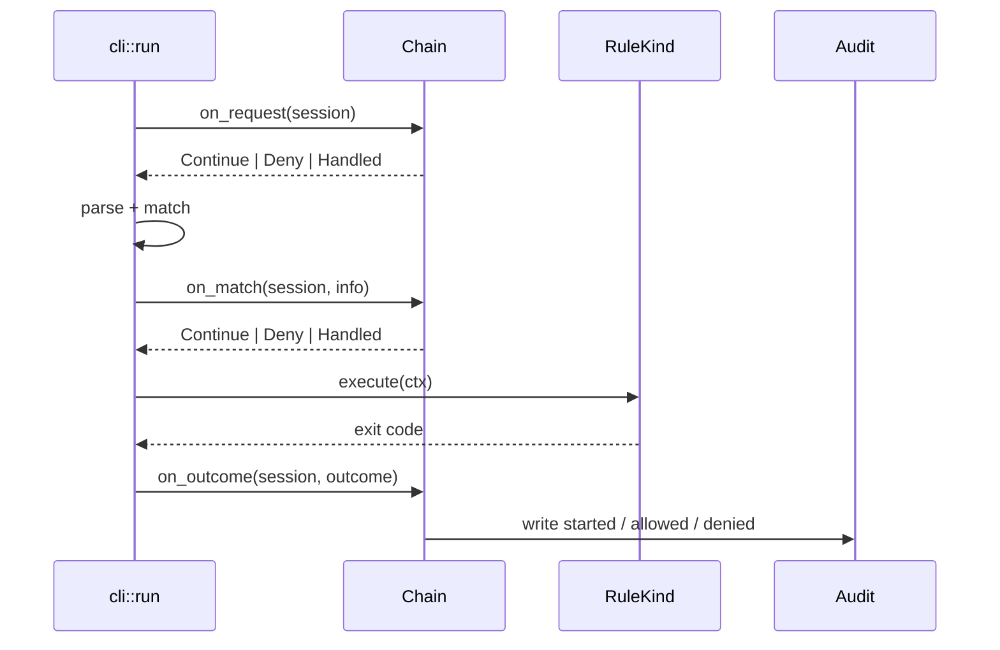

# Architecture

Developer guide to how ssh-guard is put together.
If you are looking for how to _write_ config, see [CONFIG.md](CONFIG.md); this document is about the code.

## Mental model

ssh-guard does one job: take the command an SSH user asked for, decide whether it matches a rule, then either run it or deny it.

The code is split into two extension layers on purpose:

- **Layer 1 - Rule kinds**: _what_ an action does.
  Each kind is its own module implementing the `RuleKind` trait.
- **Layer 2 - Middleware**: _cross-cutting_ behaviour around a request.
  Auditing, intercepting, secondary environment validation, etc.



## Module map

| Path | Responsibility |
| ---------------------- | ------------------------------------------------------------------------------------------------------------------------------- |
| `src/main.rs` | Binary entry. Calls `cli::run()`, logs fatal errors to syslog, sets exit code. |
| `src/lib.rs` | Crate root. Declares modules and the strict lint profile. |
| `src/cli/mod.rs` | `clap` CLI: `run`, `add-rule`, `validate`, `help`; config-path resolution. |
| `src/cli/run.rs` | The SSH runtime path: builds the session, drives the middleware chain. |
| `src/cli/validate.rs` | `validate` subcommand: config semantics + per-kind environment checks. |
| `src/cli/merge.rs` | `add-rule` subcommand: resolve a binary and merge a rule into config. |
| `src/cli/help.rs` | `help` subcommand: render generated help, colour handling. |
| `src/config/` | Serde model (`Config`, `Global`, `Rule`, `Action`, `Subcommand`, `Contract`, `Profile`, …), loading, profile merge, validation. |
| `src/engine/` | Command matching: template/flag parsing, argv matching, contract validation → `MatchResult`. |
| `src/kinds/` | **Layer 1.** `RuleKind` trait, `kind_for()` registry, one module per action kind, shared helpers. |
| `src/middleware/` | **Layer 2.** `Middleware`, `Chain`, `Decision`, `Session`, `MatchInfo`, `Outcome`, default chain. |
| `src/actions.rs` | Thin public shim: `execute()` dispatches through the kind registry; test seam for argv building. |
| `src/audit.rs` | `AuditEvent` / `AuditResult`, JSON and logfmt writers, timestamps, session ids. |
| `src/help.rs` | Shared help rendering and printing: generated `ssh-guard help` output and the configured `help_text`. |
| `src/logging.rs` | Syslog (or stderr fallback) logger init; idempotent for repeated `run()` calls. |
| `src/path_security.rs` | Canonicalisation + "is this path inside an allowed root" checks. |
| `src/errors.rs` | `GuardError` and `MatchFailure`. |

## The `run` lifecycle

`cli::run::run` is the only path that handles an SSH request.

1. Load config and hash the raw bytes.
   The hash is the audit anchor: a config edit changes it.
1. Resolve the effective config for the SSH user merging the matching profile.
1. Initialise logging with the profile's `log_tag`.
1. Read `SSH_ORIGINAL_COMMAND`.
1. Build the middleware chain and a `Session`.
1. **`on_request`** — a middleware may deny or handle the request. `Help`
   handles an empty/whitespace command here by printing help and exiting 0.
1. `shlex::split` the command. A parse failure is recorded as a denial.
1. `engine::match_command` against the effective rules.
   `NoMatch` is recorded as a denial.
1. **`on_match`** — a middleware may deny or handle the match. `DryRun` handles
   it here when enabled; `Audit` writes the `started` event.
1. `actions::execute` -> `kinds::kind_for(&rule.action).execute(ctx)`.
1. **`on_outcome`** — every middleware observes the final outcome. `Audit`
   writes `allowed` or `denied`.



### Audit guarantees

- A `started` event is written only after a rule matches and before execution.
- `allowed` / `denied` are written from `on_outcome`, so every completed path is recorded.

## Layer 1 — Rule kinds

`Action` (`src/config/action.rs`) is the serde DTO: pure data.
Behaviour lives in `src/kinds/`, and the two are joined by one exhaustive function.

```rust
pub(crate) trait RuleKind: Sync {
    fn capture_refs(&self) -> Vec<(&'static str, &str)>;  // config validation
    fn root_sets(&self) -> Vec<&str>;                     // config validation
    fn visible_in_help(&self) -> bool;                    // generated help
    fn validate_env(&self, ctx: &EnvCtx, errors: &mut Vec<String>); // validate CLI
    fn execute(&self, ctx: &ExecCtx) -> Result<i32, GuardError>;
}
```

`kind_for()` is the registry:

```rust
pub(crate) fn kind_for(action: &Action) -> Box<dyn RuleKind + '_> {
    match action {
        Action::Run { .. } => Box::new(run::Run { .. }),
    }
}
```

### Kinds and validation

- `capture_refs()` returns the action fields that name captures.
  `Config::validate_action_captures` uses it to check the capture exists on every relevant subcommand path.
- `root_sets()` returns the root sets the action reads from.
- `validate_env()` is the filesystem-aware pass used by `ssh-guard validate`.

### Adding a kind

1. Add a variant to `config::action::Action`.
1. Create `src/kinds/<name>.rs` with a borrow struct and `impl RuleKind`.
1. Add one arm to `kind_for`.
1. Fill `capture_refs` / `root_sets` if the action reads captures or roots.
1. Decide `visible_in_help`.
1. Implement `validate_env` if the kind needs filesystem checks.
1. Add unit tests next to the kind, plus a registry test in `kinds/mod.rs`.

## Layer 2 — Middleware

`src/middleware/mod.rs` defines the chain and the hooks.

```rust
pub(crate) trait Middleware: Sync {
    fn name(&self) -> &'static str;
    fn on_request(&self, s: &Session<'_>) -> Decision { Decision::Continue }
    fn on_match(&self, s: &Session<'_>, m: &MatchInfo<'_>) -> Decision { Decision::Continue }
    fn on_outcome(&self, s: &Session<'_>, o: &Outcome<'_>);
}
```

`Decision` has three outcomes:

| Value | Meaning |
| ------------------------------- | -------------------------------------------------------------------------------------------- |
| `Continue` | Pass to the next middleware. |
| `Deny(reason)` | Veto the request/match. Audited as denied; returns `GuardError::Denied`. |
| `Handled { exit_code, detail }` | The middleware handled it; short-circuit with `exit_code`. Audited as allowed with `detail`. |

Semantics:

- `on_request` / `on_match` run in order and stop at the first `Deny` or `Handled`.
- `on_outcome` always runs every middleware, in order.

### Default chain order

```rust
DryRun { enabled }  ->  Audit { log, format }  ->  Help { text }
```

- `DryRun` is first so a dry-run match short-circuits before `Audit`'s `started` event.
- `Audit` records `started` and outcomes.
- `Help` handles an empty command or a raw `help` in `on_request`.

### What middleware can and cannot do

A middleware can:

- Observe the request, match, and outcome.
- Veto the request or match with a reason.
- Handle the request or match, short-circuiting the chain and returning an exit code.

A middleware cannot:

- Mutate the command or argv.
- Mutate the config or rules.

### Adding middleware

1. Create `src/middleware/<name>.rs` implementing `Middleware`.
1. Add it to `default_chain` at the position its semantics require.
1. If it needs configuration, add a field to `Global` and `GlobalOverrides`, then wire it in `default_chain`.
1. Test the phase you use. For run-path tests, inject a chain through `run_with_chain`.

## Config model

`Config` (`src/config/mod.rs`) is the root of the TOML:

| Field | Purpose |
| --------------------- | -------------------------------------------------------------------------------- |
| `global` | Audit log/format, help text, log tag, size limits, `dry_run`. |
| `rules` | Ordered rule tree. First match wins. |
| `contracts` | Named value validators |
| `flag_groups` | Reusable flag lists referenced by rules/subcommands. |
| `roots` / `root_sets` | Allowed filesystem roots for path actions/contracts. |
| `profiles` | Per-SSH-user overlays of global, rules, contracts, roots. |

Profile merge (`Config::merge_profile`) is field-wise: globals override by
explicit field, rules append, maps merge with the profile winning on
conflicts, roots append unique.

## Matching engine

`engine::match_command(&Config, &[String]) -> Result<MatchResult, GuardError>` walks the rule tree against the parsed argv.

- Arg patterns support literals, `{string}`, `{int}`, `{any}`, named captures (`{name:string}`), contract refs (`{port}`), unions (`{int|string}`), and inline flags (`--depth={int}`).
- Captures are stored in `MatchResult.captures`; `subcommand_path` records how deep the match went.
- Contract/template validation happens during matching (fail-closed): a value that fails its contract makes the rule non-matching.
- Matching is pure and deterministic: no I/O, no side effects.

## Executing actions

`actions::execute` is a thin compatibility seam:

```rust
pub fn execute(config, rule, subcommand_path, captures, user_argv) -> Result<i32, GuardError> {
    let ctx = kinds::ExecCtx { config, rule, subcommand_path, captures, user_argv };
    kinds::kind_for(&rule.action).execute(&ctx)
}
```

## Help

- **Help output** — printed when the command is empty or exactly `help`,
  before matching. The `Help` middleware stores the resolved output at chain
  build time: `global.help_text` when set, otherwise generated help from the
  effective config (`src/help.rs`, `resolved_help`).
- **Generated help** — `ssh-guard help` walks the config and renders a usage
  listing (`src/help.rs` → `cli/help.rs`).

## Validation layers

| Layer | Runs when | Checks |
| --------------- | ------------------------------------------------- | ------------------------------------------------------------------------------------------- |
| Deserialisation | `Config::from_file` | TOML shape, types, required fields |
| Semantics | `Config::validation_errors` (validate CLI, tests) | unknown flag groups/contracts/root sets, unresolvable capture refs, duplicate profile users |
| Environment | `ssh-guard validate` → `RuleKind::validate_env` | binaries exist, absolute paths, symlink policy |
| Runtime | `run` → kind `execute` | captures present, roots enforced, operations fail closed |

## Errors and exit codes

- `GuardError` (`src/errors.rs`) is the single error type for library code.
- A denial (veto, no match, parse failure) exits `1`.
- A successful action returns the child's exit code (`Run`), or `0` for
  built-in file/help actions.
- `main.rs` prints the error, logs it to syslog when available, and exits `1`.

## Testing and toolchain

```sh
cargo test                 # unit + integration
cargo test --release       # release profile (panic = abort)
cargo fmt --check
cargo clippy --all-targets -- -D warnings
cargo bench                # divan regression benches
```

The crate uses `#![feature(coverage_attribute)]`, so it expects **nightly**
(see `flake.nix`). If you only have stable locally, `RUSTC_BOOTSTRAP=1` makes
the attribute compile; it is a local convenience, not a supported release mode.

Tests live:

- inline `#[cfg(test)] #[coverage(off)] mod tests` next to the code;
- `tests/` for cross-module flows (`integration_tests`, `interleaved_flags`,
  `path_contracts`, `example_configs`, `public_api_hashers`);
- `benches/regressions.rs` for performance-sensitive matching.

## Design invariants

1. **Behaviour is determined by the config, not the build.** No Cargo features
   gate kinds or middleware; the audit hash must identify behaviour. The one
   exception is the test-only `noop` feature, which adds a do-nothing
   placeholder action for fixture configs; it is never enabled in a release
   build, so it can never be selected at runtime.
1. **Dispatch is exhaustive.** Kinds use one `match`; there is no string→fn
   registry that could miss a variant at runtime.
1. **Fail closed on execution, fail open on audit I/O.** If a check fails, do
   not run the command. If the log is unwritable, keep serving.
1. **Middleware observes, vetoes, or handles — never mutates.**
1. **The config hash is the audit anchor.** Anything that changes behaviour
   must change the config or the binary version, not hidden state.
